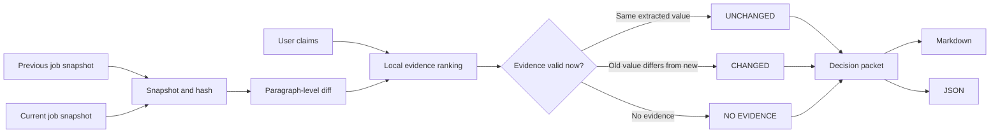

# Career Evidence Guard

> A local-first evidence agent that detects job-posting changes and reopens career decisions when their supporting evidence changes.

Career Evidence Guard compares two snapshots of a job posting, aligns user-defined claims to exact source passages, and produces an auditable decision packet. It is designed for job seekers who save a role, prepare an application, and later need to know whether the requirements, location, deadline, or work arrangement have changed.

The default workflow uses **no LLM, no search API, no vector database, and no cloud service**. The same inputs produce reproducible results that can be tested in CI.

## Why this project exists

Most job assistants answer a question once. They rarely preserve exactly which version of a job description supported the answer, and they do not reopen the decision when the source changes.

Career Evidence Guard is built around a different idea:

> A reliable agent should not only answer with evidence. It should preserve provenance and tell the user when changed evidence makes an old conclusion unsafe to reuse.

This project treats an agent as a **stateful decision system**, not a free-running chatbot. Retrieval and comparison tools observe the environment; deterministic rules control legal transitions; the system abstains when it cannot align a claim to evidence.

## Demo

The repository includes two snapshots of a fictional AI Agent internship.

In the first snapshot:

- the internship requires at least **40 hours per week**;
- applications close on **October 15, 2026**.

In the second snapshot:

- the requirement changes to **20 hours per week**;
- the deadline changes to **October 1, 2026**.

Run:

```bash
python -m career_guard scan \
  --old examples/job-v1 \
  --new examples/job-v2 \
  --claims examples/claims.json \
  --out output
```

Expected terminal output:

```text
Decision packet: output/decision_packet.md
Machine-readable report: output/report.json
Claims checked: 5
Changed / added / removed: 2
Unchanged: 2
No evidence: 1
```

The generated decision packet shows the old value, the new value, the career impact and the next action:

```text
Work location       UNCHANGED     Hong Kong Science Park → Hong Kong Science Park
Minimum work hours  CHANGED       40 hours/week → 20 hours/week
Application deadline CHANGED      2026-10-15 → 2026-10-01 (14 days earlier)
Monthly salary      NO EVIDENCE   not found → not found
```

`NO EVIDENCE` does **not** mean a statement is false. It means the supplied job sources cannot prove it, so the user should not reuse it without checking the original posting or asking the recruiter.

## Core engineering advantages

### 1. Evidence alignment, not citation decoration

A result cannot be marked `unchanged` without an exact quote, stable source ID, stable passage ID, and alignment score in both snapshots. Field extractors turn relevant passages into comparable values such as `40 hours/week` and `2026-10-15`. A generic link is not treated as sufficient proof.

### 2. Change-aware decisions

Each source and passage receives a SHA-256 hash. Paragraph-level diffs identify which current passages changed. The report explains the change as an old-to-new value, including a deadline delta when possible, and connects it to a concrete job-seeker action.

### 3. Safe abstention

When neither snapshot contains sufficient evidence, the program returns `no_evidence`. It does not claim the statement is false, generate a plausible answer, or invent a source. This behaviour is covered by automated tests.

### 4. Zero-cost default execution

The first version uses only the Python standard library:

- local Markdown / TXT files;
- TF-IDF-style lexical evidence ranking;
- SHA-256 snapshots;
- paragraph-level `difflib` comparison;
- deterministic numeric checks;
- Markdown and JSON reports.

There are no paid API calls and no API key is required.

### 5. Human-readable and machine-readable output

Every run produces:

- `decision_packet.md` for a job seeker or reviewer;
- `report.json` for later automation, dashboards, or a GitHub Action;
- a state trace showing every legal workflow transition.

### 6. Explicit limits

The output records the intended source limit, claim limit, alignment threshold, network calls, and LLM calls. This makes execution cost and system boundaries visible rather than implicit.

## Architecture



## Agent control flow

This is intentionally a **bounded agentic workflow**, not an autonomous web researcher.

```text
validate inputs
→ snapshot sources
→ detect changes
→ retrieve evidence for one claim
→ check evidence and numeric facts
→ extract old and new values
→ explain unchanged / changed / no evidence
→ continue to the next claim
→ write an auditable packet
```

The environment result determines the next state:

- same extracted value in both snapshots → `unchanged`;
- different extracted values → `changed`;
- value only in the new or old snapshot → `added` / `removed`;
- insufficient evidence in both snapshots → `no_evidence`;
- invalid input → stop before analysis.

The model is not allowed to convert missing evidence into a positive decision.

## Project structure

```text
career-evidence-guard/
├── career_guard/
│   ├── __main__.py
│   ├── alignment.py      # local ranking and evidence decisions
│   ├── cli.py            # scan command and workflow orchestration
│   ├── models.py         # typed dataclasses
│   ├── reporting.py      # Markdown + JSON decision packets
│   ├── snapshots.py      # hashing, content-addressed passage IDs and diffs
│   └── state_machine.py  # legal states and auditable transitions
├── examples/
│   ├── claims.json
│   ├── job-v1/job-posting.md
│   └── job-v2/job-posting.md
├── tests/test_core.py
├── pyproject.toml
└── README.md
```

## Quick start

Requirements:

- Python 3.11 or later
- no external dependency

Run from the repository root:

```bash
python -m career_guard scan \
  --old examples/job-v1 \
  --new examples/job-v2 \
  --claims examples/claims.json \
  --out output
```

Or install the CLI locally:

```bash
python -m venv .venv
source .venv/bin/activate       # Windows: .venv\Scripts\activate
pip install -e .
career-guard scan \
  --old examples/job-v1 \
  --new examples/job-v2 \
  --claims examples/claims.json \
  --out output
```

## Claims format

```json
{
  "claims": [
    {
      "id": "C1",
      "label": "Minimum weekly hours",
      "field": "min_hours",
      "text": "The internship requires at least 40 hours per week.",
      "anchors": ["hours per week"]
    }
  ]
}
```

`anchors` are optional domain terms that improve local retrieval. They are not hidden labels: the user can inspect and edit them.

## Run the tests

```bash
python -m unittest discover -s tests -v
```

The initial tests verify:

- modified passages are detected;
- unchanged location evidence produces a clear `unchanged` result;
- changed hours and deadline show their old and new values;
- the deadline output explains that it moved 14 days earlier;
- a salary statement without evidence produces `no_evidence`, not `false`;
- Markdown and JSON reports are generated;
- the default path makes zero network and LLM calls.

## Design decisions

### Why not use an LLM in v0.1?

The first goal is to establish a reproducible evidence baseline. A model can later help split long user notes into atomic claims or interpret ambiguous passages, but it should not become the sole source of truth. Keeping v0.1 deterministic also makes failures easier to understand and tests cheaper to run.

### Why not use embeddings or a vector database?

A saved job application normally contains a small source pack. For this scale, local lexical ranking is fast, inspectable, and sufficient for a first version. Embeddings become useful only after evaluation shows a measurable retrieval gap.

### Why not scrape job websites automatically?

Automatic crawling introduces robots restrictions, layout changes, authentication, privacy concerns, and unreliable content. v0.1 accepts saved Markdown / TXT snapshots. A later adapter can import content only from sources the user is authorised to access.

### Why these five outcomes?

`unchanged`, `changed`, `added`, `removed`, and `no_evidence` are user-facing outcomes rather than internal system codes. They answer the user's immediate questions: what changed, from what to what, how does it affect my application, and what should I do next? More statuses should be added only when real evaluation cases require them.

## Known limitations

- The lexical ranker does not understand deep paraphrases or negation reliably.
- `changed` means the extracted old and new values differ; users should still review both original passages before acting.
- Markdown and TXT are supported in v0.1; PDF and web import are not included.
- The sample job is fictional and is not employment advice.
- Users must review the original posting before applying.

These limitations are deliberate and documented. The project demonstrates reliable control and abstention before adding model complexity.

## Evaluation roadmap

The next evaluation set should include at least 20 cases across:

- unchanged requirements;
- changed numeric requirements;
- changed deadlines;
- removed requirements;
- salary or visa claims with no evidence;
- paraphrased requirements;
- negated requirements;
- multiple conflicting sources;
- malformed input files.

Primary metrics:

```text
Evidence passage accuracy
Claim-status accuracy
No-evidence abstention rate
Changed-evidence detection recall
Zero-LLM completion rate
```

## Roadmap

- [x] Markdown / TXT snapshots
- [x] SHA-256 source and passage hashes
- [x] Paragraph-level change detection
- [x] Local claim-to-evidence alignment
- [x] Numeric fact preservation
- [x] Markdown and JSON decision packet
- [x] Automated core tests
- [x] GitHub Actions test workflow
- [ ] PDF import with page metadata
- [ ] Human review field and override history
- [ ] Optional one-call LLM claim atomizer
- [ ] GitHub Action that attaches a decision packet to a pull request
- [ ] Evaluation dashboard based on recorded fixtures

## Security and privacy

- No source files leave the machine in the default workflow.
- No API key is required.
- `.env`, local databases, and generated output are ignored by Git.
- Do not commit real resumes, private job applications, access tokens, or personal correspondence.

## What this project demonstrates

For recruiters and reviewers, the repository is intended to demonstrate:

- explicit state and decision boundaries;
- tool-like components with clear contracts;
- local retrieval and structured evidence;
- content hashing and change detection;
- safe abstention instead of hallucinated certainty;
- human-readable and machine-readable outputs;
- automated tests for both success and failure paths;
- cost-conscious AI system design.

## License

MIT
